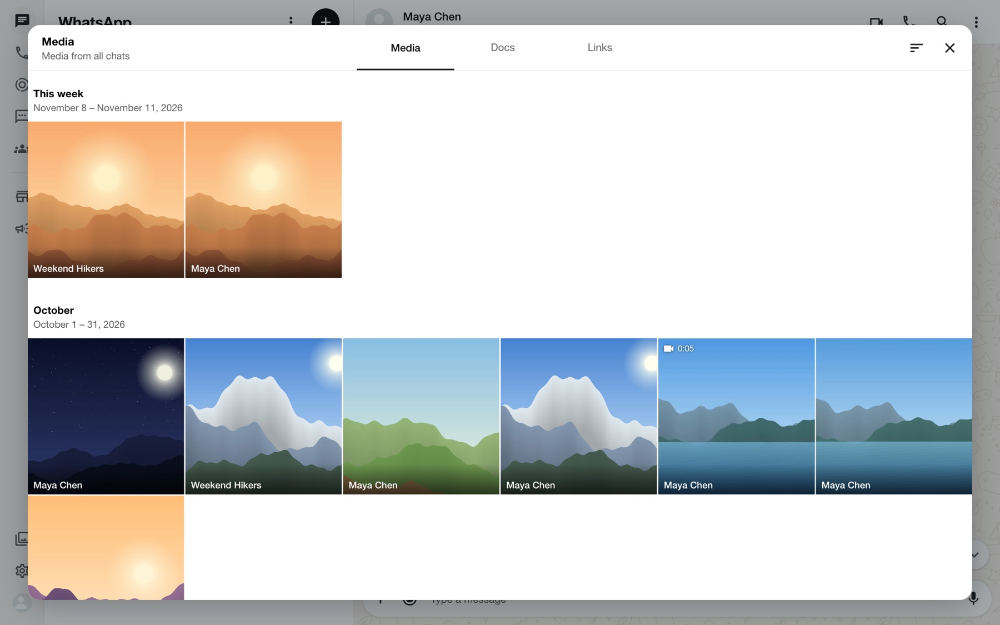

# WhatsApp Chat Viewer

Read your exported WhatsApp chats in an interface that looks and feels like WhatsApp Web: photos, videos, voice messages, calls, search and all.

It is **view only**, runs entirely on your own machine, and has **no dependencies** beyond Node.js or Docker.


> **Not affiliated with WhatsApp.** This is an independent, read-only viewer for chats you exported yourself. It is not affiliated with, endorsed by or connected to WhatsApp or Meta. "WhatsApp" is a trademark of its owner. The chats in these screenshots are fictional samples.

## Features

- **Looks like WhatsApp Web** in light and dark mode, on desktop and phone-sized screens.
- **Imports the export .zip directly.** Drag it in; nothing to unzip or convert.
- **All the message types an export contains**: text with formatting and links, photos, videos, GIFs, stickers, voice messages, documents, contact cards, locations, polls, calls, edited and deleted messages, and group events.
- **Voice messages** with a real waveform, scrubbing and 1×, 1.5×, 2× speed.
- **Search** every message in a chat, or jump straight to a date.
- **Media, links and docs** for one chat or across all chats, with filters and sorting.
- **Calls tab** listing every call found in your chats.
- **Chat themes**: 26 wallpapers and bubble colours, custom colours, or your own background image.
- **Group chats** with coloured sender names and system messages.
- **Persistent**: imported chats are kept in a Docker volume (or a local folder), so they are still there after a restart.
- **Private**: your chats are never sent anywhere. There is no account, analytics or external request.

| Every message type | Group chats and polls |
| --- | --- |
|  |  |

| Search and jump to date | Media, links and docs |
| --- | --- |
|  |  |

| Calls | Chat themes |
| --- | --- |
|  |  |

| Dark mode | Settings |
| --- | --- |
|  |  |

<p align="center">
  
  &nbsp;&nbsp;
  
</p>

## Run it

### Docker (recommended)

```bash
git clone https://github.com/ajalilmian/whatsapp-chat-viewer.git
cd whatsapp-chat-viewer
docker compose up -d
```

Open <http://localhost:8080>. Imported chats, settings and your custom background are stored in the `chat-data` volume and survive restarts and rebuilds.

To stop it, run `docker compose down`. Add `-v` only if you also want to delete the saved chats.

By default the port is bound to your own machine (`127.0.0.1`). To open the viewer from other devices on your network, change the port line in `docker-compose.yml` to `"8080:8080"`. There is no login, so only do this on a network you trust.

### Node.js (no install step)

Needs Node.js 18 or newer.

```bash
node server.js
```

Open <http://localhost:5178>. Chats are saved in a `data/` folder next to the app.

| Variable | Default | Meaning |
| --- | --- | --- |
| `PORT` | `5178` | Port to listen on |
| `HOST` | `127.0.0.1` | Address to bind to |
| `DATA_DIR` | `./data` | Where chats and settings are saved |

### Static files only

The app also works from any static file server, for example `python3 -m http.server`. In that case imported chats are kept in the browser's own storage (IndexedDB) instead of on a server, so they are tied to that one browser.

## Use it

### 1. Export a chat from WhatsApp

1. Open the chat on your phone.
   - **iPhone:** tap the contact or group name at the top, then **Export chat**.
   - **Android:** tap the three dots, then **More**, then **Export chat**.
2. Choose **Attach media** (iPhone) or **Include media** (Android) to keep photos, videos and voice messages.
3. Save the resulting `.zip` and get it onto your computer. Do not unzip it.

### 2. Import it

Click the **+** button above the chat list, or drag the `.zip` anywhere onto the window. You can import as many chats as you like.

Want to try it first? Import the two fictional chats in [`sample/`](sample).

### 3. Look around

- **Which side is you:** your messages should be on the right. The viewer works this out from the chat names; if it guesses wrong, pick your name under **Settings → Which side is you**. It applies to every chat.
- **Search:** the magnifier in a chat searches every message. The calendar next to the search box jumps to a day.
- **Media, links and docs:** click a chat's name for everything shared in it, or the gallery icon in the left rail for all chats at once.
- **Calls:** the phone icon in the left rail. Click a call to see it in context.
- **Themes:** **Settings → Chat theme** changes the wallpaper and bubble colour, or lets you use your own picture.
- **Help:** **Settings → How to use** repeats these steps inside the app.


## Good to know

- **View only.** The message box, call buttons and some menu items are there to match the look; they do nothing.
- **What an export does not contain.** WhatsApp leaves out reactions, which message a reply was to, read receipts, forwarded labels and profile photos, so the viewer cannot show them.
- **Tested mostly with iPhone exports.** Android's export format is supported by the parser but has had less testing. If a chat does not load correctly, please open an issue with a few anonymised lines of the `.txt` file.
- **Browsers.** Built and tested in Chrome. It uses standard web features and should work in current Firefox, Edge and Safari.

## Privacy

- Your chats stay in the folder or Docker volume you run the viewer from. Nothing is uploaded to any third party.
- The server only serves the app's own files and the chats you imported. It has no login, which is why it listens on `127.0.0.1` by default.
- The `.gitignore` excludes `*.zip` and `data/` so a real export cannot be committed by accident if you fork this.

## How it works

```
index.html, css/, js/   The app. Plain HTML, CSS and JavaScript, no build step.
  js/parser.js          Turns the export's text file into messages (iOS and Android layouts).
  js/zip.js             Reads the export .zip lazily, so media is only loaded when shown.
  js/store.js           Saves chats to the server, or to the browser when there is no server.
  js/app.js             Everything you see.
server.js               A small dependency-free server with persistent storage.
assets/chat-bg.svg      The doodle wallpaper, generated by tools/make-doodles.js.
sample/                 Two fictional exports to try the viewer with.
```

The wallpaper doodles are original artwork generated by `tools/make-doodles.js`. Interface icons are from Google's [Material Icons](https://fonts.google.com/icons) (Apache License 2.0).

To use a different wallpaper tile, save an SVG as `assets/chat-bg.local.svg`; `server.js` serves it in place of the bundled one, and it is ignored by git.

## Disclaimer

This project is an independent, unofficial viewer. It is not affiliated with, endorsed by, sponsored by or connected to WhatsApp LLC or Meta Platforms, Inc. "WhatsApp" is a trademark of its owner and is used here only to describe the files this tool reads. Only use it with chats you have the right to view.
